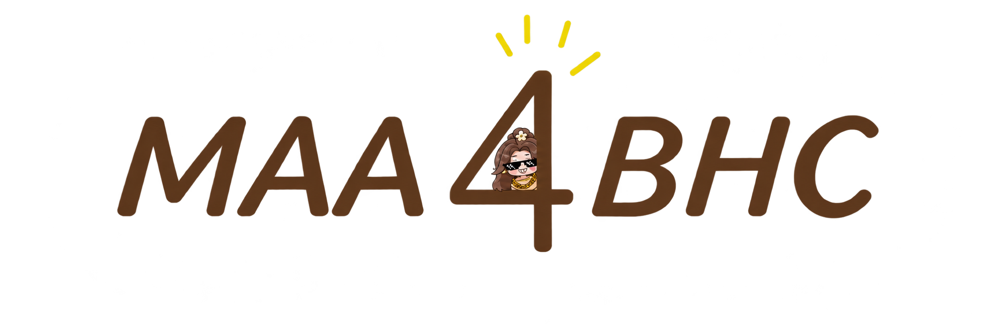

  

# MAA For SSBHC

虽然，恨的番茄在 2026 年 9 月 20 日的热更新里加入了“小助理”的功能，但是 Michael 有充足的理由相信，有很多百货老板在同时玩多个账号，或者出于学业或工作的原因无法天天上号，时时刻刻在线。

于是，MAA 时尚百货城诞生了！

它的基础原理：**先看看你的百货城现在是什么情况，比如背包里有多少资源、角色养到了什么程度；再根据你的目标，想想接下来该做什么、哪些资源该留着。对于适合交给它做的事情，它会按你确认的安排，帮你完成操作。**

毕竟，小助理只是把一些最基本的任务帮你解决了，而大活动、小游戏，这些都需要你（zhao）自（dai）己（gan）来完成。而 MAA For SSBHC，就是为了这些小助手做不到的事情诞生的。

## 项目当前阶段

**版本：v0.x｜开发进度：约 20%**

MAA For SSBHC 目前还处于比较早期的开发阶段。虽然已经开始写代码，也做过一些实际测试，但距离“下载下来就能放心使用”还有一段距离。

目前已经完成或尝试的内容包括：

- **连接与截图**：通过 ADB 连接模拟器，获取游戏画面。
- **背包采集**：在特定分辨率下，自动滑动普通道具页面并截图。
- **本地识图**：尝试识别截图中的道具名称和数量，生成待核对的记录。
- **人工校对**：识别不准的地方可以修改、标记无效；完成核对后可以导出 CSV。
- **角色目录**：开始为以后区分不同角色的配置和资料做准备。

目前最大的问题还是**识图准确率和完整性**：道具名称、数量可能识别错误或漏掉，现阶段不能把识别结果直接当作准确库存。其他背包分类、资源变化统计、活动和小游戏等功能也还没完成。

> 这里的 20% 是对当前整体进度的粗略估计，不代表每项功能都完成了 20%，也不代表发布日期已经确定。

## 以后想做什么

希望有一天，MAA For SSBHC 能帮百货老板做到：

- 一键清体，少花时间做重复操作。
- 尽可能高效地消耗体力，让有限的体力发挥更大作用。
- 在小游戏中争取更好的成绩，有概率进入大神榜。
- 帮你整理背包，看看手里有什么、还差什么。
- 根据活动和榜单情况，帮你考虑资源是现在用，还是先留一留。
- 协助处理角色养成、活动和日常任务，减少需要时时盯着的时间。
- 对于需要消耗重要资源的操作，先让老板知道并决定，再按确认的安排执行。

这些都是**想实现的目标，不是目前已经做好的功能**。实际能做到什么程度，还要看后续开发和游戏内测试。

## 怎么开始

**还在开发中，暂时没有可以直接安装使用的正式版本。** 等基础功能和安装流程稳定后，这里会补上适合普通玩家的下载和使用教程。

## 反馈与交流

有想法或者遇到问题，欢迎来反馈！

- 反馈邮箱：----------
- QQ 交流群：----------

## 说明

本项目是个人开发的第三方项目，与《时尚百货城》官方无关。
