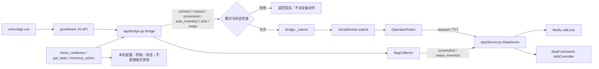

# 设备动作调用链（W02-01）

核对日期：2026-11-16。本文针对当前工作区代码；接管前已有未提交修改仍属于原有差异。本文记录调用与保护边界，不表示任何游戏操作已授权或已实测。

## UI 到设备

UI 的 `act(name, ...)` 动态调用 `window.pywebview.api[name](../...)`。背包任务首页当前调用 `inspect_device`、`auto_inventory` 和 `stop`；旧通用页面还暴露 `connect`、`screenshot`、`click`、`swipe`。准备检查 `check_readiness`、轮询 `get_state` 和 `inventory_action` 是本机检查／记录操作，不等于设备命令。

## 设备入口及实际动作

| 入口 | 后端路径 | 设备动作 | 当前限制／结果 |
| --- | --- | --- | --- |
| `connect` | `Bridge.connect` → `_submit(resume=True)` → `MaaDevice.connect` | `adb connect`、读取 window/display 信息、创建 `AdbController`、连接与设置原始截图坐标 | 检查 ADB 文件名、绝对路径和 `127.0.0.1:port` 格式；Bridge 离线时拒绝。代码检查没有设备租约前置。 |
| `inspect_device` | `Bridge.inspect_device` → 可选重连 → `_device.screenshot(save=False)` | 必要时连接；读取当前截图并返回 UI | 对当前页面仅靠显示屏与画面；不操作页面。截图不保存为常规截图文件。 |
| 普通 `screenshot` | `Bridge.screenshot` → `_submit` → `_device.screenshot` | 确认目标显示屏后截屏；默认写入 `runtime/screenshots/` | 设备连接失效或显示屏配置变化时报错。 |
| 普通道具 `screenshot` | `Bridge.screenshot` → `_capture_inventory` | 截图后写入本轮草稿，尝试本地 OCR；失败保留疑问 | `MaaDevice` 以只读控制器初始化；不点道具。 |
| `auto_inventory` | `Bridge.auto_inventory` → `_submit` → `BagCollector.run` | 读取背包页、回顶、截取图像、受限 `swipe_inventory`、截图核实位移 | 仅 inventory automation 模式开放；当前只有普通道具采集器。每次滑动后用新画面估算位移。 |
| `click` | `Bridge.click` → 检查最新 frame 坐标范围 → `_submit` → `_device.click` | `AdbController.post_click` | 只读／背包采集模式拒绝；通用可写模式仍允许坐标点击，动作后要求截图核对。 |
| `swipe` | `Bridge.swipe` → 检查 frame 坐标和时长 → `_submit` → `_device.swipe` | `AdbController.post_swipe` | 只读／背包采集模式拒绝；通用可写模式仍允许坐标滑动，动作后要求截图核对。 |
| 背包受限滑动 | `BagCollector` → `_device.swipe_inventory` | `adb shell input touchscreen ... swipe` | 仅启用 inventory swipe；只接受 up/down 和代码限定距离，按当前尺寸映射坐标；完成后采新截图验证。超时会停止并要求核对。 |

另有开发 CLI `python -m app.bag_capture`：自行创建 `SerialWorker` 和 `MaaDevice`，先尝试取得 `SessionLease`，再连接并执行同一个 `BagCollector`。它不是 Vue→Bridge 路径。`scripts/run.ps1 -CaptureCheck`也会从 `main.py` 自动调用 Bridge 的只读连接与截图检查。

## 串行、取消与当前租约范围

- `Bridge._submit` 先拒绝离线操作；除连接／重连外要求已连接状态，再交给该进程的 `SerialWorker`。同一 worker 只允许一个活动或排队操作。
- `OperationToken.dispatch` 与 `stop()` 共用 worker gate。停止增加 generation、清空尚未开始的排队任务；`dispatch` 返回后不能再提交新的受保护动作。
- 若一个本机或 MaaFramework 原生动作已提交，停止不能撤销游戏已经收到的动作。设备方法会等待部分原生任务结束并检查结果；超时或失败需重新读取真实状态，禁止盲目重放。
- `SessionLease` 是 Windows 文件锁，位置为每个项目根自己的 `runtime/manual-inventory/session.lock`。主程序仅在手动／自动背包记录模式取得该锁；离线 smoke test 不取锁。开发 CLI 也取得此锁。默认通用 UI 与只读 capture-check 当前不取锁。
- 该锁仅协调同一项目根下使用它的进程；不同克隆目录使用不同锁文件，不能阻止其他自动化程序或用户手工操作同一模拟器。每进程一个 `SerialWorker` 不构成设备级互斥。

## 页面与动作结果边界

- `MaaDevice._select_game_display` 会尝试确认百货城包名对应唯一逻辑／物理显示屏；截屏前检查显示屏配置没有变化。这不等于验证了当前任务页面、活动或账号身份。
- 通用 `click`／`swipe` 只绑定最近截图的坐标范围。当前没有通用页面指纹、旧画面动作失效协议或跨软件画面冲突检测。
- `BagCollector` 对普通背包做标题／布局检查，并在滑动后比较图像位移；这属于背包专用校验，不可泛化为所有游戏动作的安全机制。
- 普通点击／滑动接口返回后只提示“请截图核对实际结果”；没有自动核对页面后置条件，也没有独立持久化 `submitted_unknown` 动作记录。
- `app/ocr.py` 的 `ImageController` 在本机图像上运行，不是游戏设备控制路径。

## W03 前置缺口

1. 给每个模拟器形成跨路径稳定的实例身份，并实现跨项目副本竞争租约。
2. 收敛所有真实设备入口，或让通用模式、截图检查和开发 CLI 都经过同一设备租约及取消检查。
3. 盘点并检测已知外部操作者；无法确认独占时停止，不擅自结束其他进程。
4. 为动作绑定最新页面／状态指纹，提交前写意图，分别记录未提交、提交未知、核实成功和核实失败。
5. 停止后给 UI 返回准确的“正在停止／已停止／需核实”，对已提交动作先查结果。

源码索引：[App.vue](../../../ui/src/App.vue)、[main.py](../../../app/main.py)、[bridge.py](../../../app/bridge.py)、[worker.py](../../../app/worker.py)、[device.py](../../../app/device.py)、[bag_capture.py](../../../app/bag_capture.py)、[reset.py](../../../app/reset.py)。
